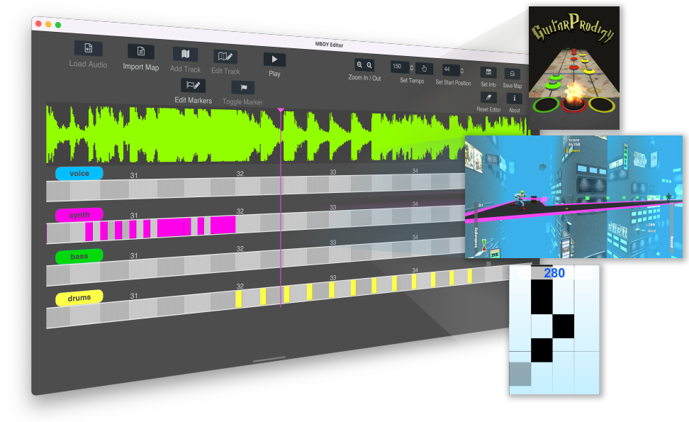

# MBOY Editor
ONE editor for ALL rhythm-based games


Create rhythm maps aka flow/charts/beatmaps in the editor, then use it in any game engine.

Get rhythm maps examples at https://mboy-games.com/

Download compiled version from Itch https://vfpe.itch.io/mboy-editor

## Supported Godot version

It's compatible with Godot 3

## Installing
To run the project you need to compile Godot engine with the custom audio waveform module.
Get the the module from this repo and follow the instructions in its readme file:
https://github.com/v-pukman-gd/godot-audio-waveform-module


## Games examples

Beat shooter https://github.com/v-pukman-gd/beat-shooter-godot

Music tiles https://github.com/v-pukman-gd/music-tiles

Guitar Hero clone https://github.com/v-pukman-gd/guitar-hero-clone

Related YouTube videos https://www.youtube.com/@vfpe2203/videos

## Push to Itch (Notes for myself)
add `version.txt` to folder and make a `.zip` file

```
cd EXPORT/2.2
butler push WIN.zip vfpe/mboy-editor:win --userversion 2.2
butler push MACOS.zip vfpe/mboy-editor:mac --userversion 2.2
butler push LINUX.zip vfpe/mboy-editor:linux --userversion 2.2
```

```
cd /Users/boom/Projects/godot/EXPORT/2.1.1
butler push MACOS.zip vfpe/mboy-editor:mac --userversion 2.1.1
butler push WIN64.zip vfpe/mboy-editor:win --userversion 2.1.1
butler push LINUX64.zip vfpe/mboy-editor:linux --userversion 2.1.1
```

## Community

The project is open for the community contribution.

Initially created by Victor Pukman.

Let's make interesting rhythm-based games together!
